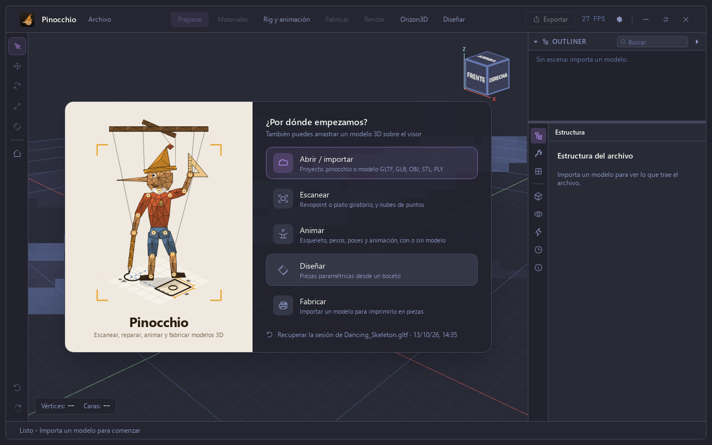
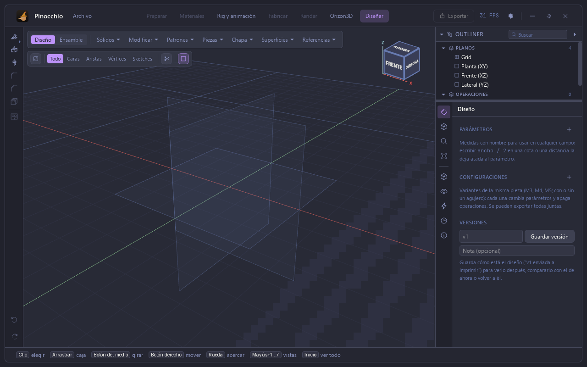
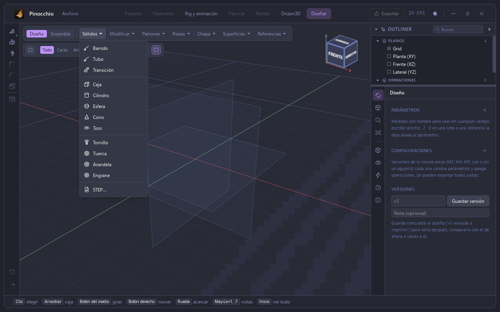
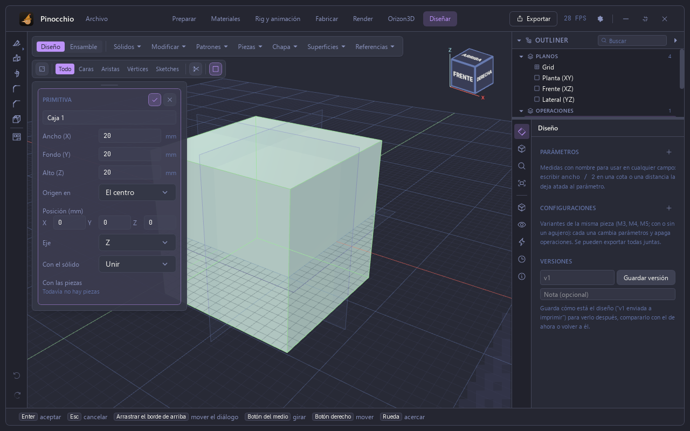
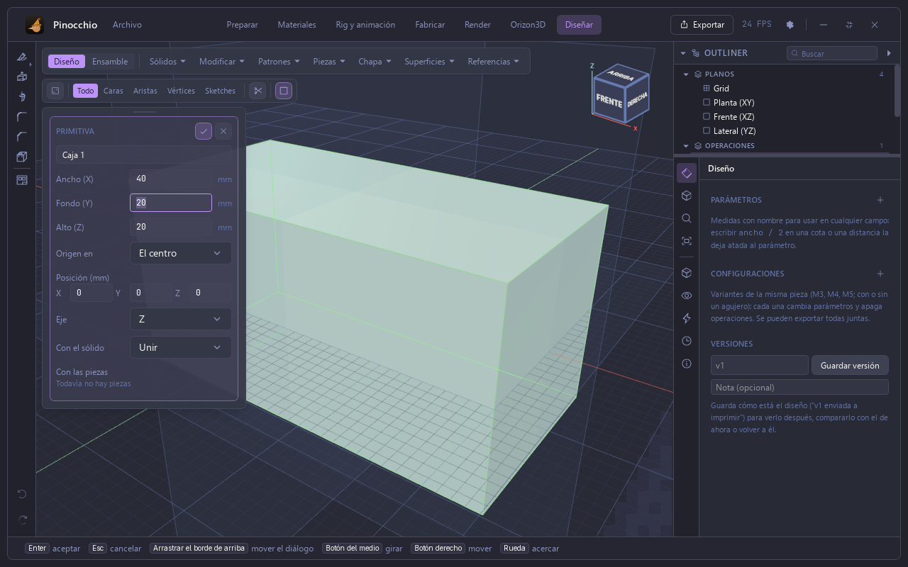
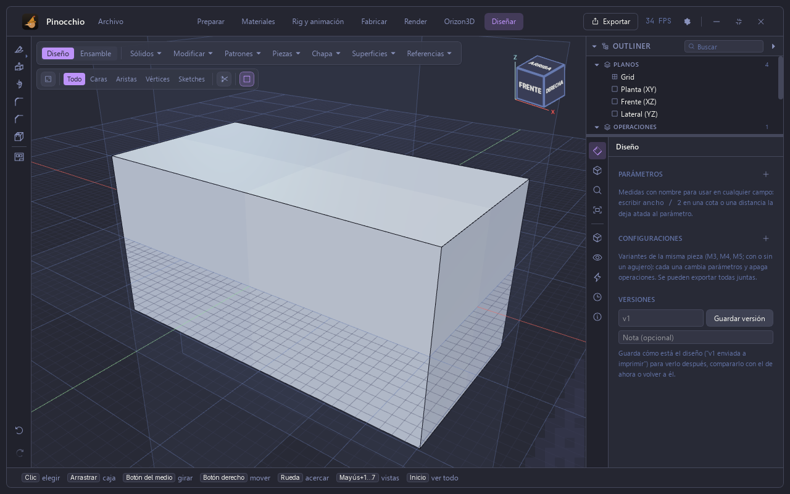
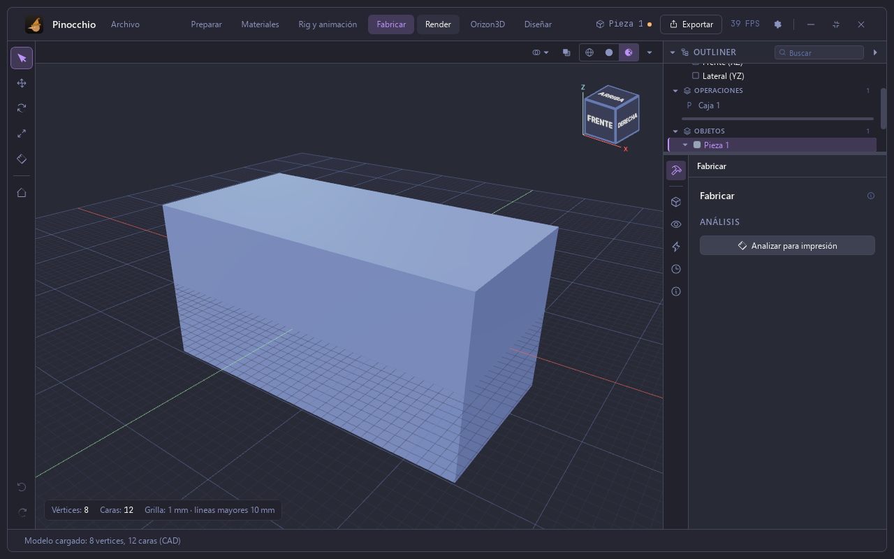
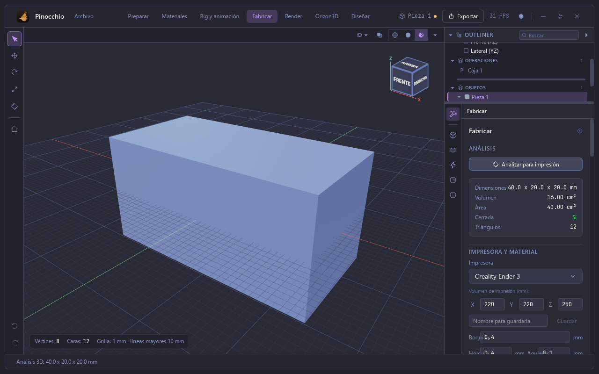

# Manual de Pinocchio — 1. Primeros pasos

Capturas hechas con la app real (Tauri) en una pantalla virtual de 1280×800,
con una pieza sintética (una caja). Borrador: se amplía por secciones.

## Pantalla de inicio

Al abrir la app aparece «¿Por dónde empezamos?» con cinco caminos: **Abrir /
importar**, **Escanear**, **Animar**, **Diseñar** y **Fabricar**. También se
puede arrastrar un modelo 3D sobre el visor, y la app ofrece recuperar la
última sesión.

## Diseñar: una caja

Diseñar es el espacio de piezas paramétricas. Arriba están los menús
**Sólidos**, **Modificar**, **Patrones**, **Piezas**, **Chapa**, **Superficies**
y **Referencias**. A la derecha, el **Outliner** (planos, operaciones, objetos)
y el panel con parámetros, configuraciones y versiones.

**Sólidos** ofrece barrido, tubo, transición, caja, cilindro, esfera, cono, toro,
tornillo, tuerca, arandela, engrane e importar STEP.

Al elegir **Caja** se abre el diálogo de la primitiva: ancho, fondo y alto
(20 mm por defecto), dónde está el origen, la posición, el eje y cómo se une
con el sólido. La vista previa se ve en verde. **Enter** acepta y **Esc**
cancela.

Se escribe una medida (aquí, ancho 40 mm) y se acepta con el botón ✓.

## Fabricar: analizar una pieza

La pieza pasa sola a **Fabricar**. El botón **Analizar para impresión** mide
la malla: para esta caja, 40,0 × 20,0 × 20,0 mm, 16,00 cm³ de volumen,
40,00 cm² de área, malla cerrada y 12 triángulos. Debajo se elige la
impresora (aquí, Creality Ender 3) y el material.

