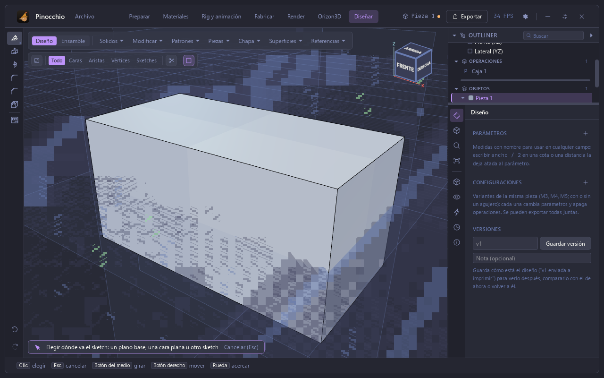
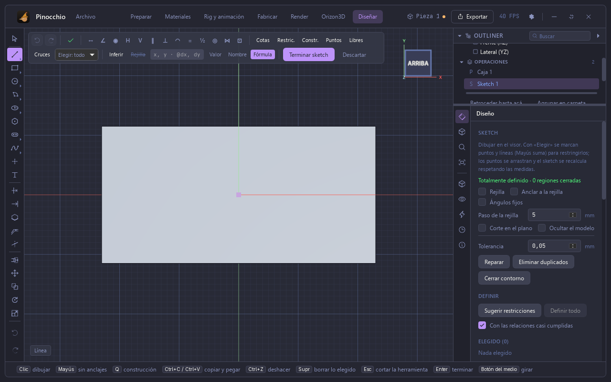
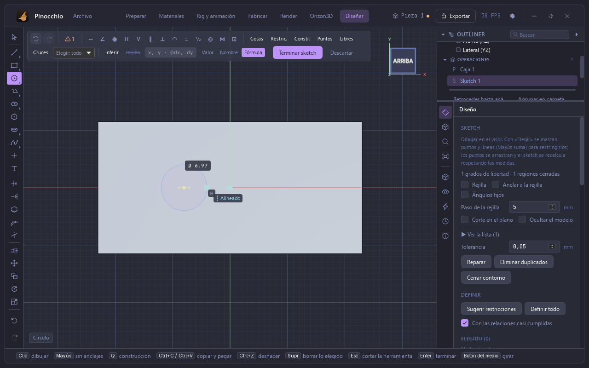
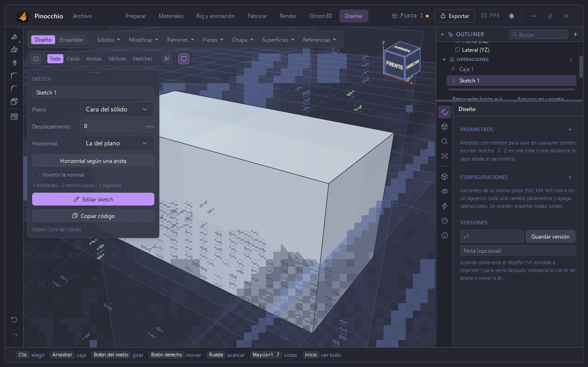
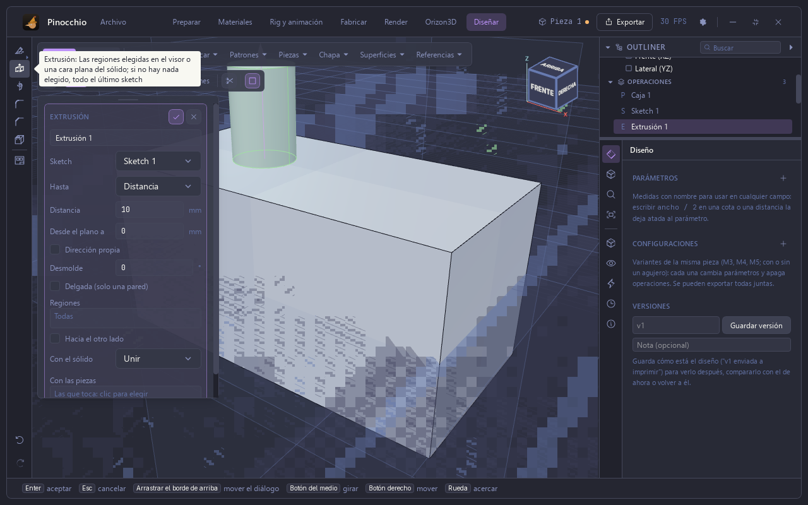
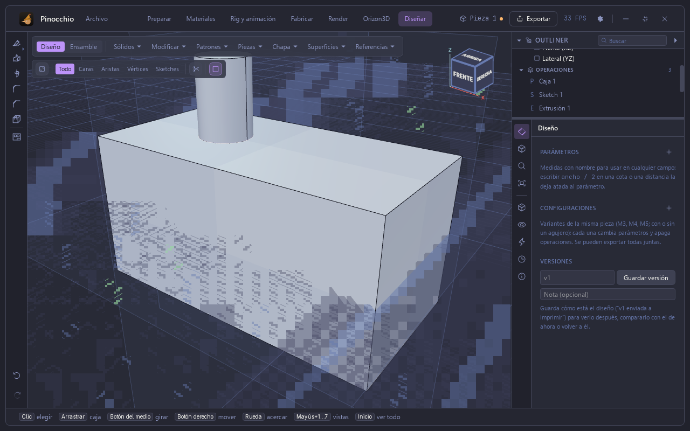
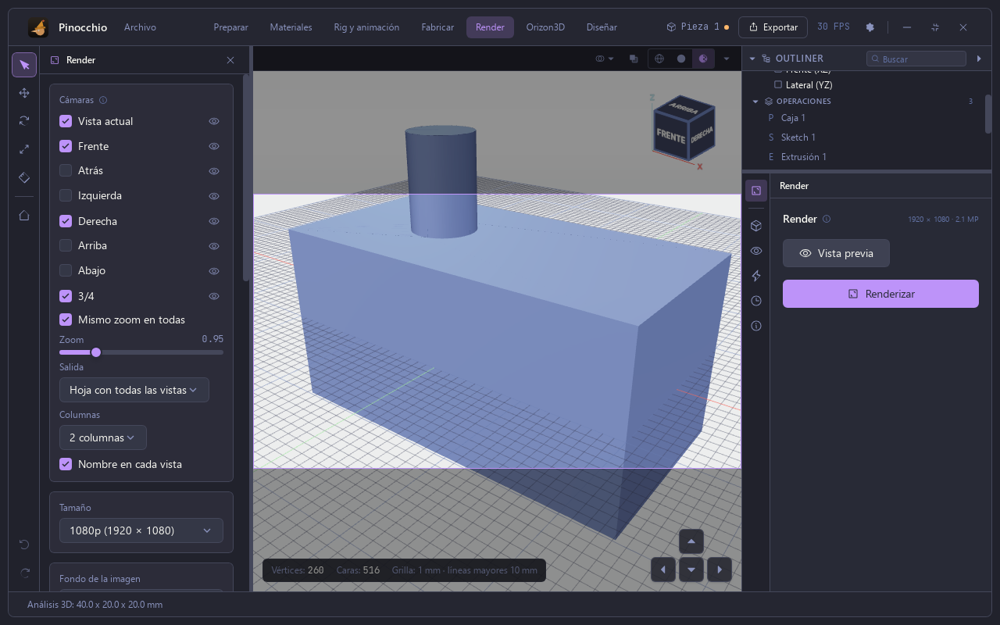
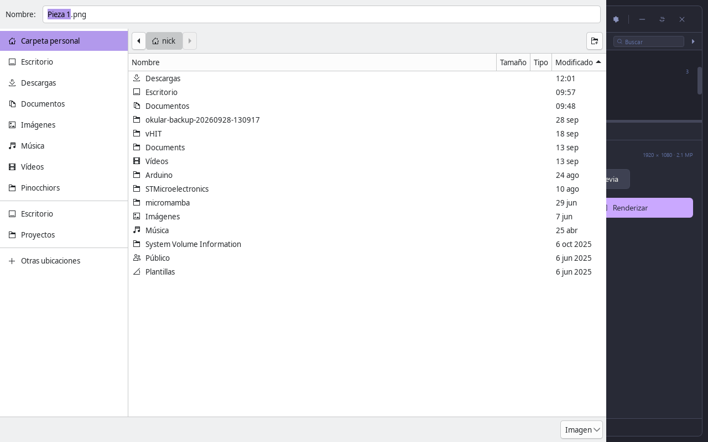
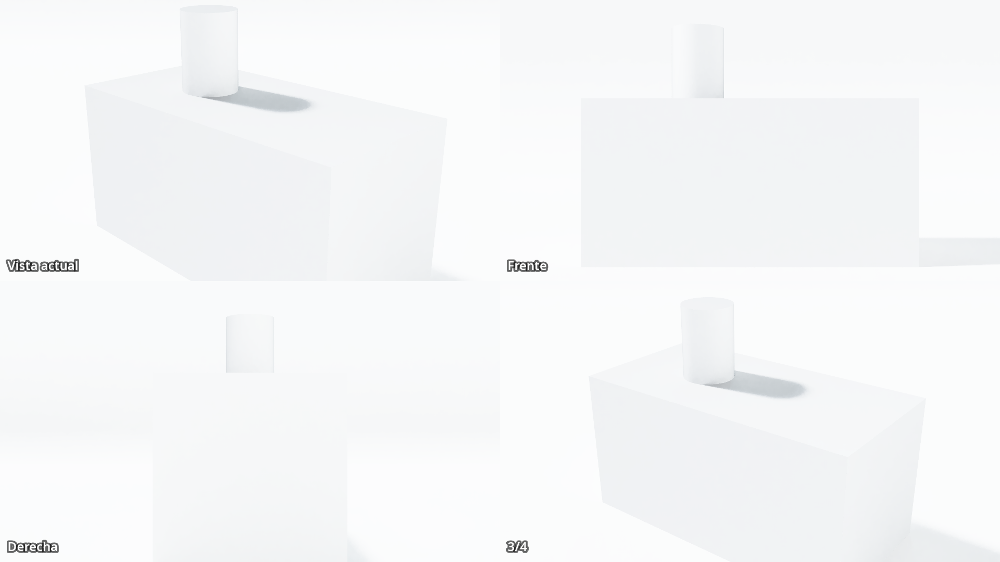

# Manual de Pinocchio — 2. Sketch, extrusión y render

Sigue de [1. Primeros pasos](01_primeros_pasos.md): la caja de 40 × 20 × 20 mm.
Capturas de la app real (Tauri) en una pantalla virtual; el visor se dibuja por
software, así que la grilla puede verse con ruido que no aparece en una tarjeta
gráfica.

## Sketch sobre una cara

La herramienta **Sketch** (la primera de la barra izquierda) pide elegir dónde
va: un plano base, una cara plana u otro sketch. Hacer clic en la cara de
arriba de la caja abre el sketch y mira la pieza de frente.

En el sketch se dibuja con las herramientas de la izquierda (línea, rectángulo,
círculo, arco, elipse, polígono, spline, texto…). Arriba aparecen las
restricciones y las cotas. El panel de la derecha dice cuántos grados de
libertad le quedan al dibujo y cuántas regiones cerradas tiene.

Un círculo: clic en el centro y clic en el borde. Mientras se dibuja muestra el
diámetro y las restricciones que sugiere («Alineado»).

**Terminar sketch** cierra la edición.

## Extruir

La herramienta **Extrusión** toma el último sketch (o las regiones elegidas en
el visor). El diálogo pide: qué sketch, hasta dónde (distancia), la distancia
(10 mm por defecto), desde qué plano, la dirección propia, el desmolde, si es
delgada, qué regiones, si va hacia el otro lado y cómo se une con el sólido.

## Render

La sección **Render** usa GeppettoRay, el motor de trazado de rayos propio.
A la izquierda se eligen las cámaras (Vista actual, Frente, Atrás, Izquierda,
Derecha, Arriba, Abajo, 3/4), el zoom, la salida (una hoja con todas las
vistas, en 2 columnas), el tamaño (1080p), el fondo y los nombres de cada vista.
A la derecha: **Vista previa** y **Renderizar**.

**Renderizar** pide dónde guardar el PNG y arranca. El panel muestra el
porcentaje, la pasada (por ejemplo «Pasada 5 de 12 · 55 de 128 muestras») y el
tiempo que falta; **Cancelar** lo detiene. La imagen se va afinando mientras
se calcula.

Resultado: una hoja con las cuatro vistas elegidas. La sombra del cilindro cae
sobre la caja y las aristas se ven vivas.

