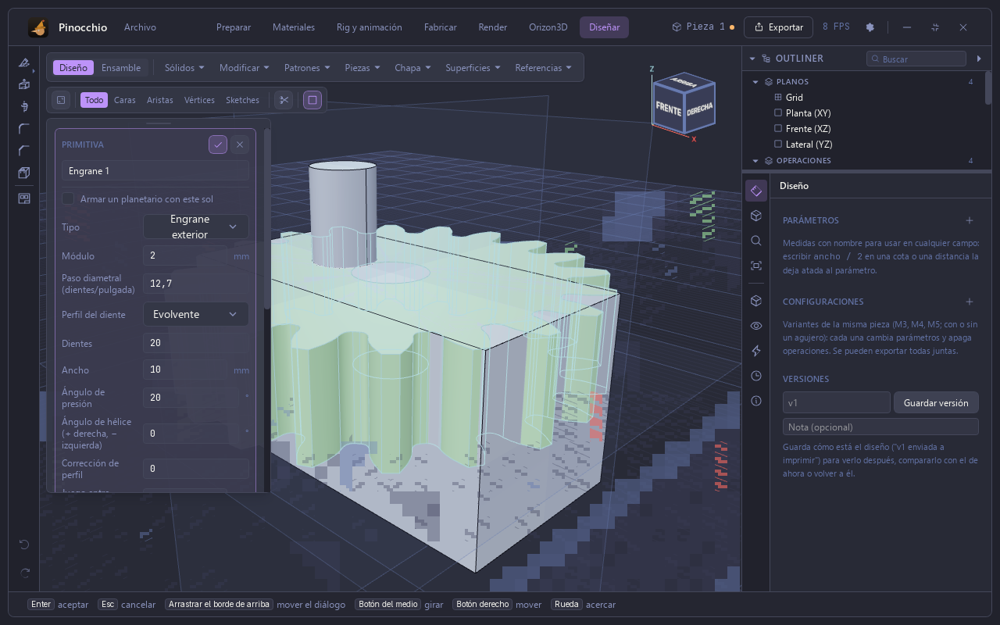
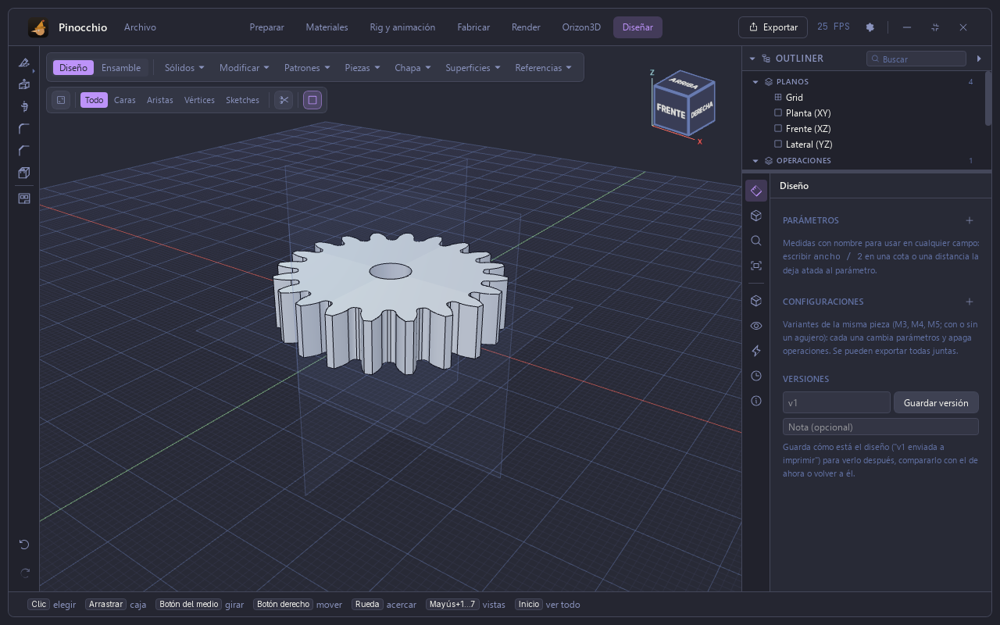
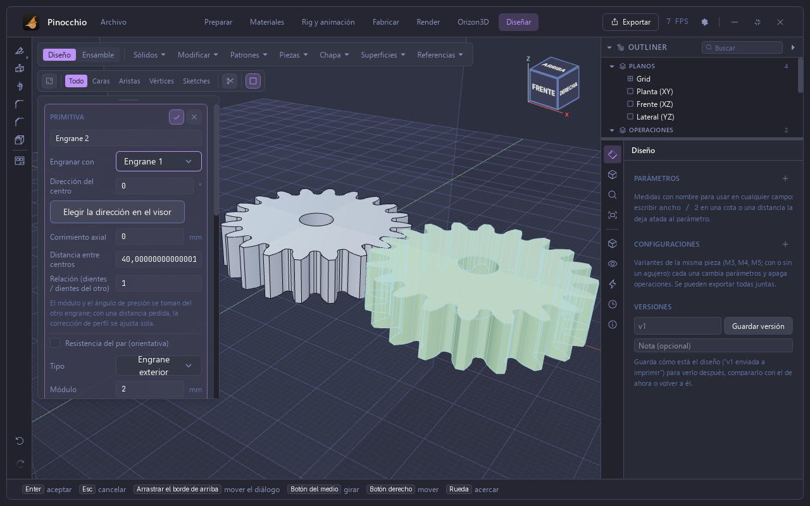
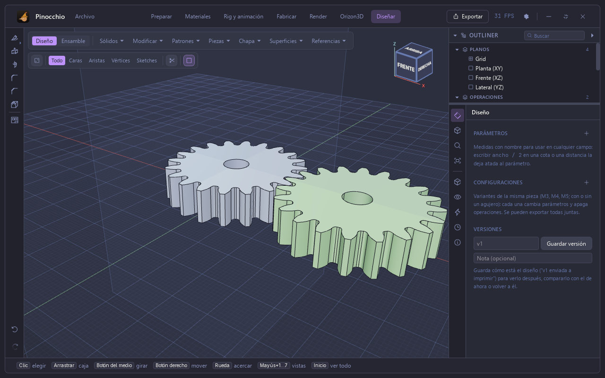
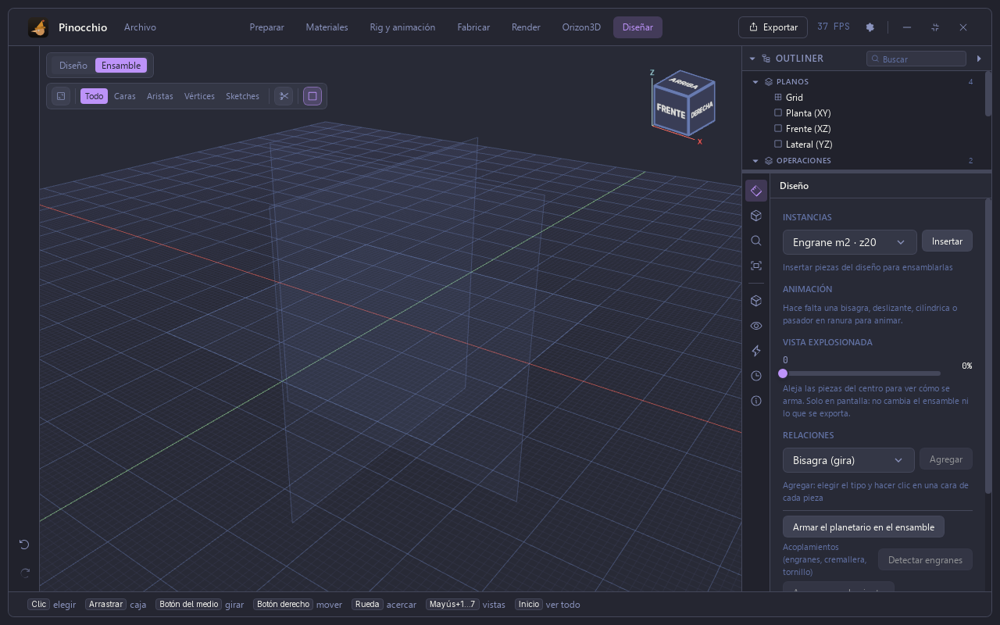
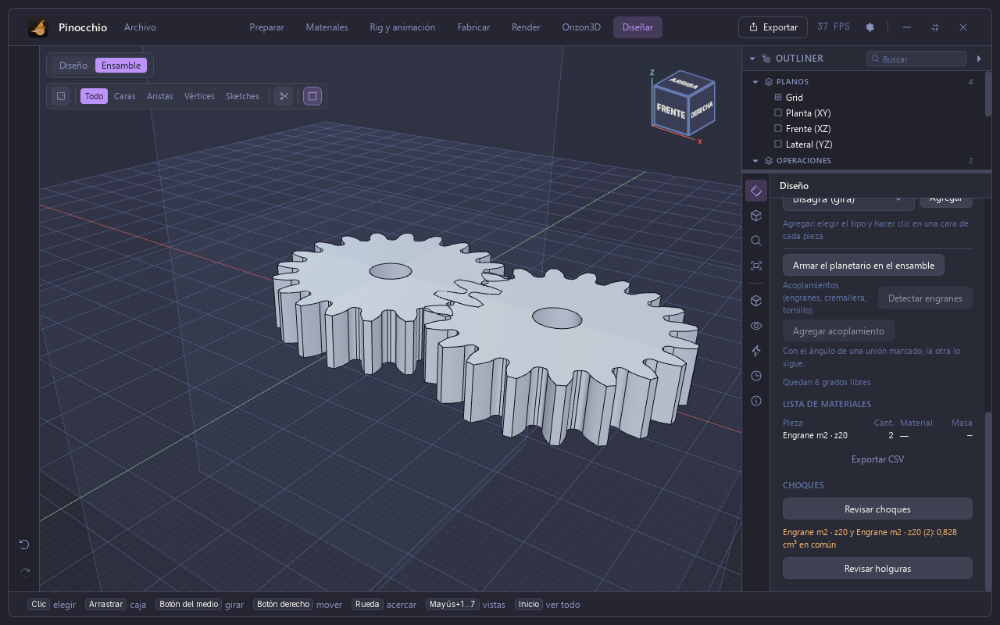

# Manual de Pinocchio — 3. Engranes y ensambles

Capturas de la app real (Tauri) con piezas sintéticas.

## Un engrane

**Sólidos ▸ Engrane** abre el diálogo de la primitiva. Por defecto es un
engrane exterior de módulo 2 mm, 20 dientes, 10 mm de ancho y 20° de presión.
El diálogo ofrece el paso diametral (dientes por pulgada), el perfil del diente
(evolvente), el ángulo de hélice, la corrección del perfil, el juego entre
dientes y la opción de armar un planetario con este engrane como sol.

## Engranar con otro

Un segundo engrane ofrece **Engranar con**. Al elegir «Engrane 1» el módulo y
el ángulo de presión se toman del otro, y la distancia entre centros se
calcula sola (aquí 40 mm para dos engranes de 20 dientes). Se puede cambiar la
dirección del centro, el corrimiento axial y la relación de dientes.

## Ensamble

El modo **Ensamble** (junto a Diseño) arma piezas. A la derecha:
**Instancias** (insertar una pieza del diseño tantas veces como se quiera,
con su posición y giro, y la casilla **Fija**), **Animación**, **Vista
explosionada**, **Relaciones** (bisagra, deslizante, cilíndrica, pasador en
ranura…), **Armar el planetario**, **Acoplamientos** (**Detectar engranes**),
la lista de materiales y la revisión de choques y holguras.

**Revisar choques** mide el volumen común entre piezas. Con dos engranes
insertados a 34 mm (en vez de 40) informa: «Engrane m2 · z20 y Engrane m2 ·
z20 (2): 0,828 cm³ en común».

Nota: la rueda del mouse sobre un campo numérico cambia su valor. Para
desplazar el panel, poner el puntero sobre un título o texto, no sobre un campo.
