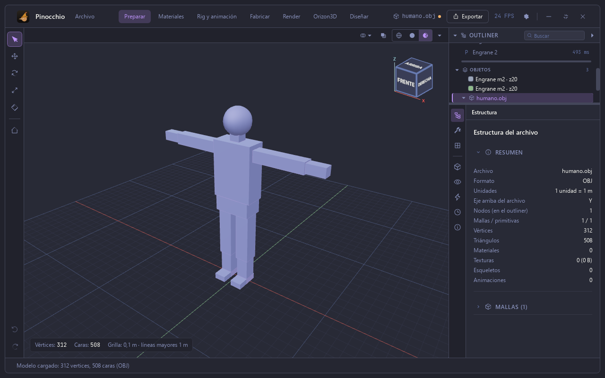
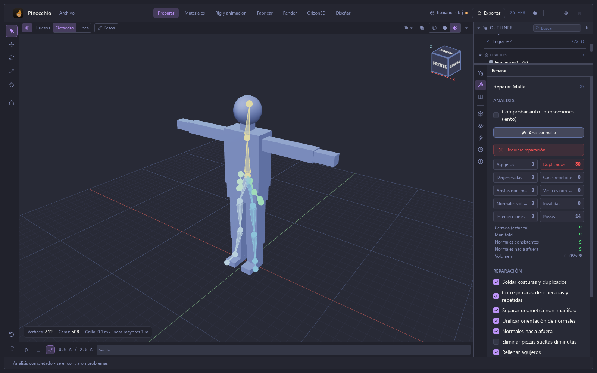
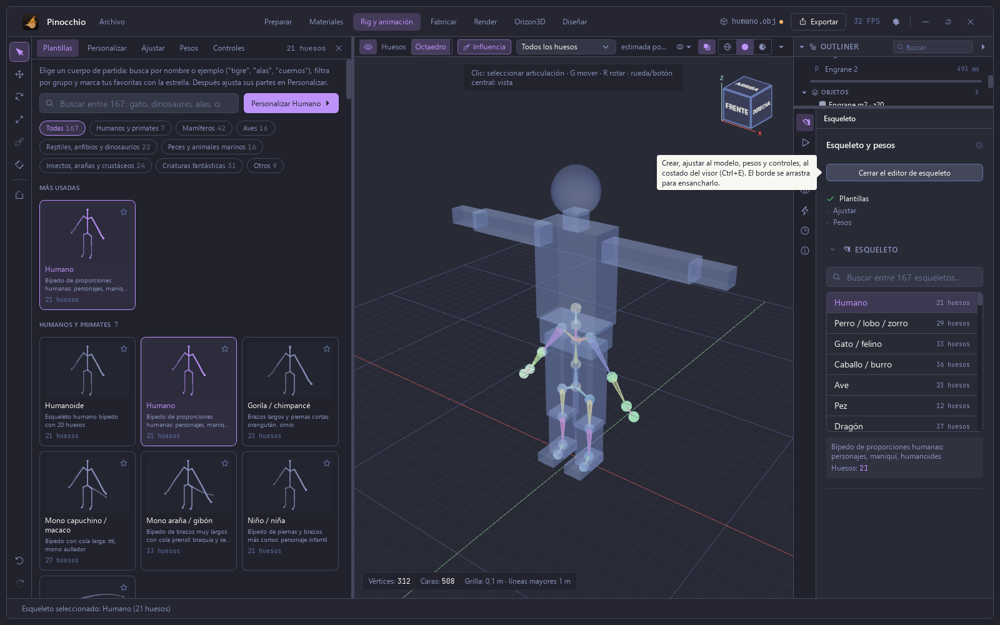
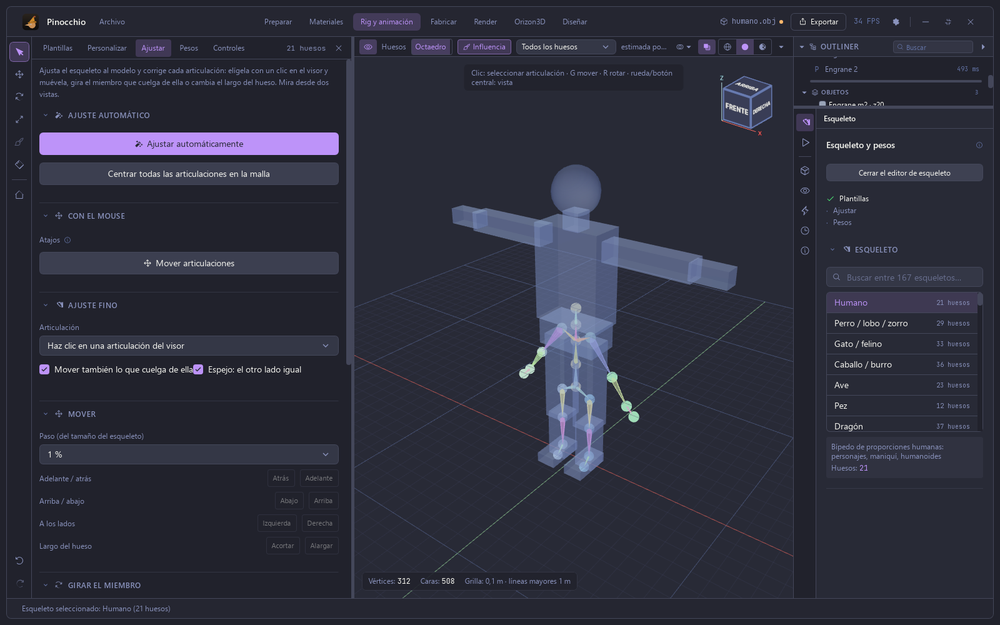
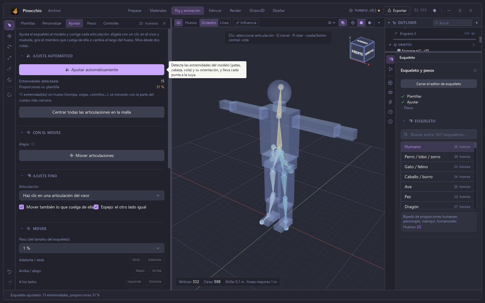
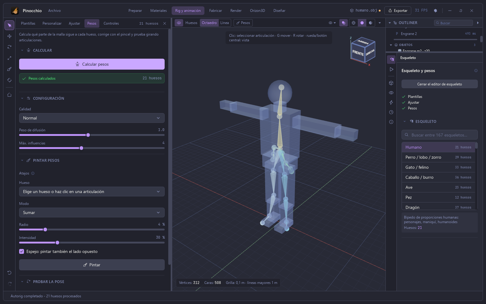
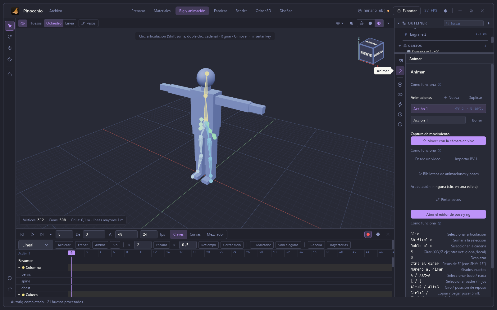
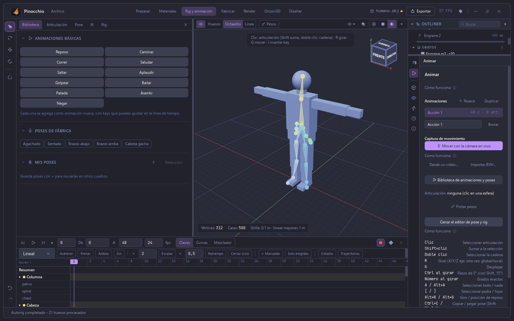
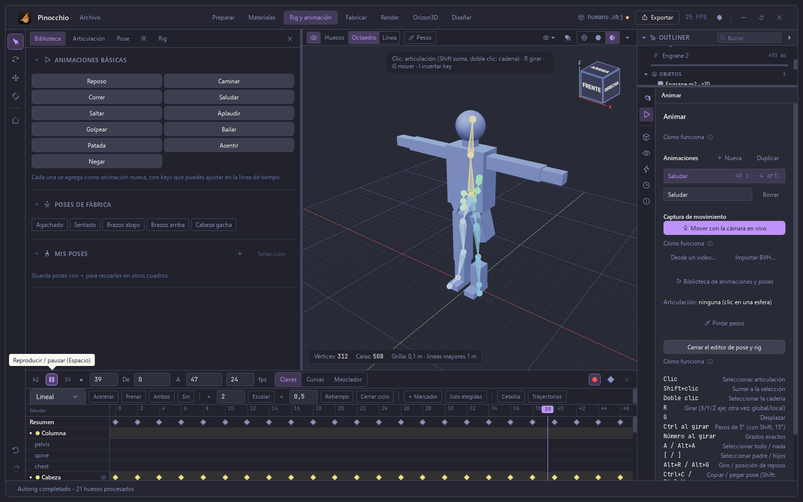
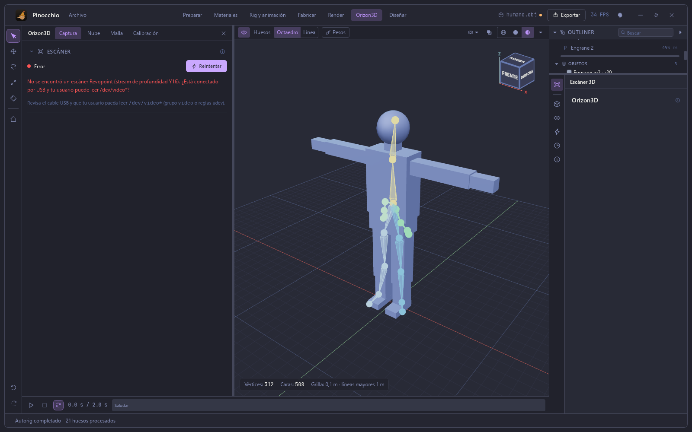

# Manual de Pinocchio — 4. Importar, reparar, rig y animación

Capturas de la app real (Tauri). Modelo: un humanoide sintético en T hecho de
cajas y una esfera (312 vértices, 508 triángulos).

## Importar un modelo

**Archivo ▸ Importar modelo…** (Ctrl+I) abre el selector de archivos. Acepta
GLTF, GLB, OBJ, STL y PLY. La pestaña **Estructura** resume el archivo: formato,
unidades, eje arriba, mallas, vértices, triángulos, materiales, texturas,
esqueletos y animaciones. La tecla **Inicio** encuadra todo el modelo.

## Reparar

En **Preparar**, el icono de la llave abre **Reparar malla**. **Analizar
malla** cuenta agujeros, duplicados, caras degeneradas y repetidas, aristas
y vértices non-manifold, normales invertidas, caras inválidas, intersecciones
y piezas; y dice si la malla es cerrada, manifold, de normales consistentes y
hacia afuera, y su volumen. Para el humanoide de cajas: 30 duplicados y 14
piezas (cada caja es una pieza), cerrada y manifold.

## Esqueleto

En **Rig y animación**, la lista ofrece 167 plantillas de esqueleto («Humano»,
perro/lobo/zorro, gato, caballo, ave, pez, dragón…). **Abrir el editor de
esqueleto** (Ctrl+E) lo abre al costado del visor, con cinco pestañas:
**Plantillas**, **Personalizar**, **Ajustar**, **Pesos** y **Controles**.

**Ajustar ▸ Ajustar automáticamente** detecta las extremidades del modelo y
lleva cada punta a la suya. Informa cuántas detectó y qué tanto se parecen las
proporciones a la plantilla. Con un modelo tan simple como este, de cajas,
detectó 15 extremidades y las proporciones salieron al 31 %: las piernas y la
columna quedaron bien y los brazos no. Para eso están el **Ajuste fino** (clic
en una articulación del visor y moverla) y **Mover articulaciones**.

**Pesos ▸ Calcular pesos** reparte qué parte de la malla sigue a cada hueso.
Muestra «Pesos calculados · 21 huesos». Después se corrige con el pincel
(**Pintar pesos**: hueso, modo, radio, intensidad, espejo) y se prueba la pose.

## Animar

El panel **Animar** lista las animaciones del modelo, permite crear, duplicar y
borrar, capturar movimiento (con la cámara en vivo, desde un video o importando
BVH) y abrir el editor de pose y rig. Abajo está la línea de tiempo (claves,
curvas y mezclador; interpolación, acelerar, frenar, escalar, retiempo, cerrar
ciclo, marcadores…).

La **Biblioteca** trae animaciones básicas (reposo, caminar, correr, saludar,
saltar, aplaudir, golpear, bailar, patada, asentir, negar) y poses de fábrica
(agachado, sentado, brazos abajo, brazos arriba, cabeza gacha). Cada una se
agrega como una animación nueva con keys que se ajustan en la línea de tiempo.

«Saludar» crea 48 cuadros con 4 articulaciones y se reproduce con la barra
espaciadora. Como en este modelo los brazos no quedaron ajustados, el saludo
solo mueve el tronco.

## Escáner (Orizon3D)

La sección **Orizon3D** tiene las pestañas **Captura**, **Nube**, **Malla** y
**Calibración**. Sin un escáner conectado, **Conectar** responde con un aviso
claro: «No se encontró un escáner Revopoint (stream de profundidad Y16). ¿Está
conectado por USB y tu usuario puede leer /dev/video*?», con la pista de
revisar el cable y los permisos (grupo `video` o reglas udev).

