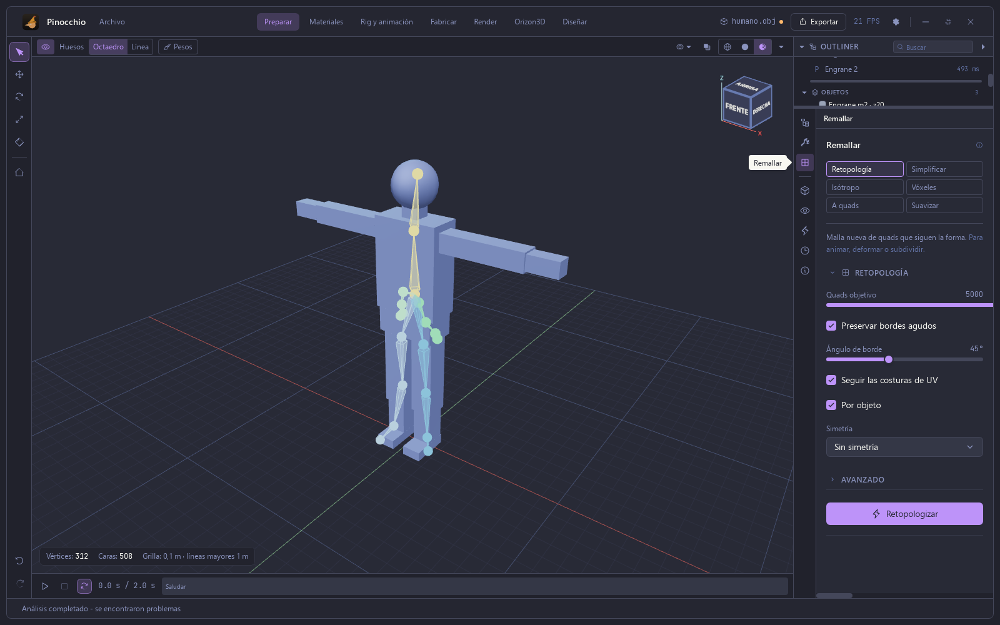
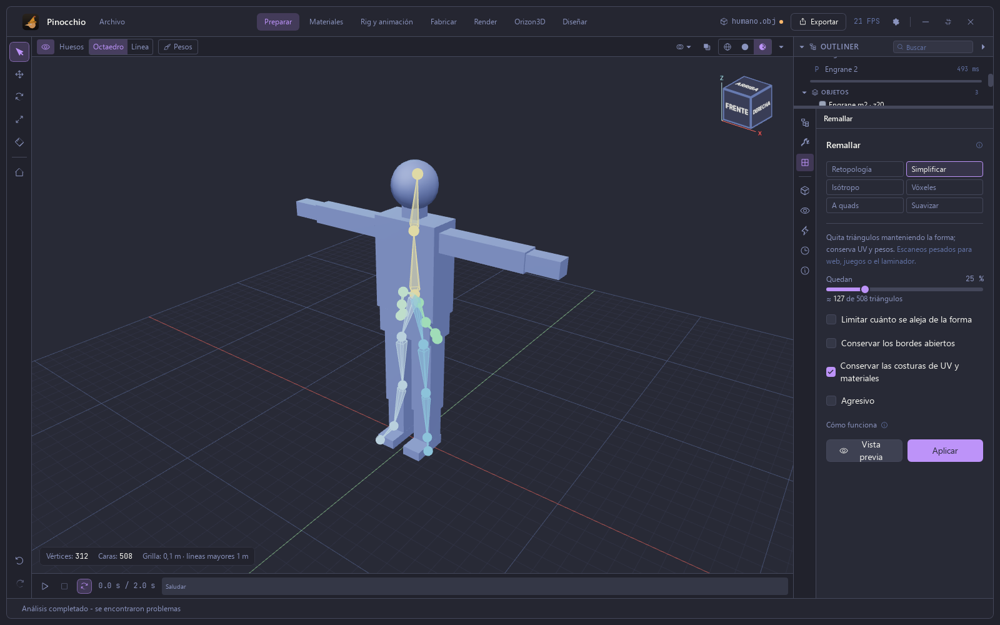
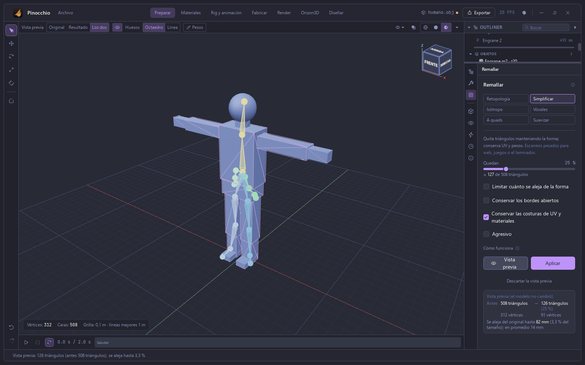
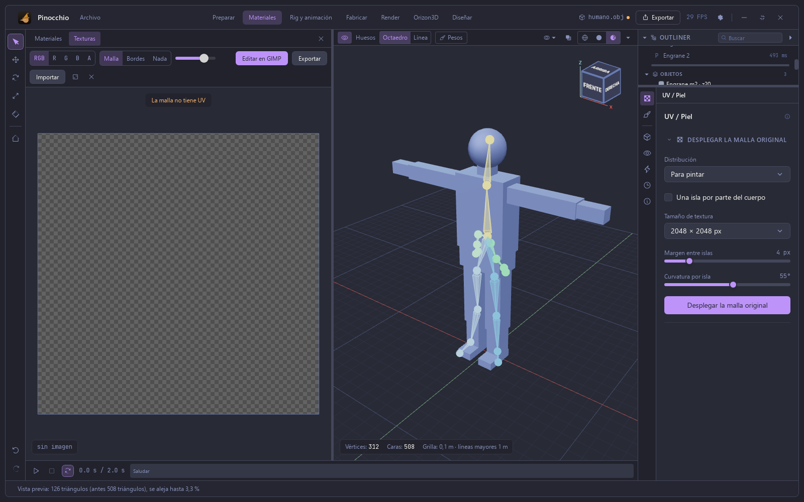
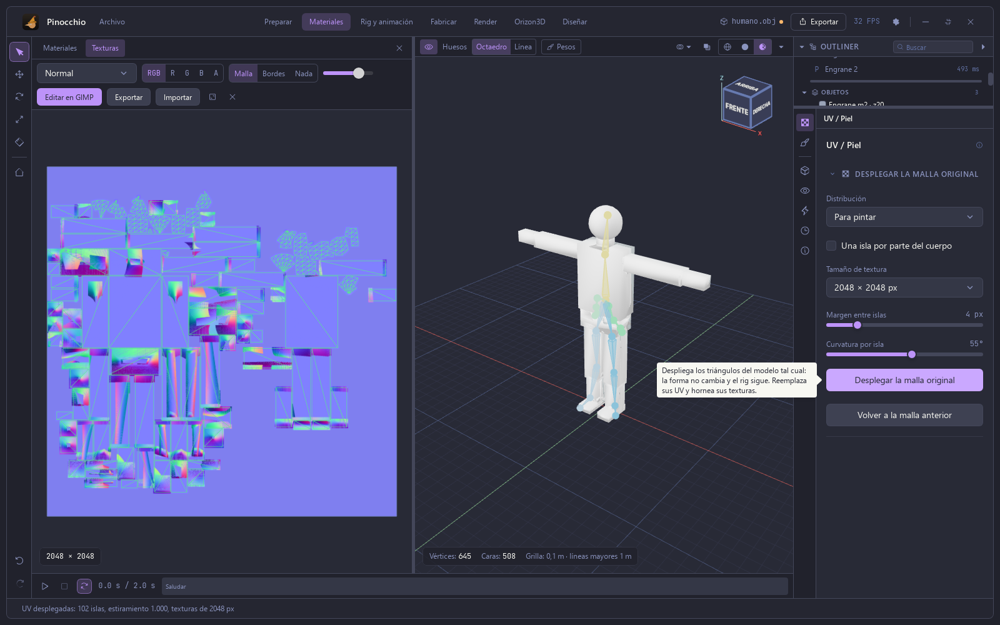

# Manual de Pinocchio — 5. Remallar y UV

Capturas de la app real (Tauri). Modelo: el humanoide sintético en T del
capítulo 4 (312 vértices, 508 triángulos).

## Remallar

En **Preparar**, el tercer icono del panel derecho abre **Remallar**, con seis
modos: **Retopología**, **Simplificar**, **Isótropo**, **Vóxeles**, **A quads** y
**Suavizar**.

**Retopología** genera una malla nueva de quads que siguen la forma, para
animar, deformar o subdividir. Se elige el número de quads objetivo (5000 por
defecto), si se preservan los bordes agudos (con su ángulo, 45°), si se siguen
las costuras de UV, si se trabaja por objeto y la simetría.

**Simplificar** quita triángulos manteniendo la forma, conserva UV y pesos, y
sirve para escaneos pesados que van a web, juegos o al laminador. Se elige el
porcentaje que queda (aquí 25 %, unos 127 de 508 triángulos) y hay opciones
para limitar cuánto se aleja de la forma, conservar los bordes abiertos y las
costuras de UV y materiales, y un modo agresivo.

**Vista previa** no cambia el modelo: muestra el resultado en el visor
(Original, Resultado o Los dos) y un resumen: de 508 a 126 triángulos (25 %),
de 312 a 91 vértices, con una desviación máxima de 82 mm (3,3 % del tamaño)
y promedio de 14 mm. **Aplicar** lo aplica; **Descartar la vista previa**
vuelve atrás.

## Materiales y UV

La sección **Materiales** tiene dos pestañas: **Materiales** y **Texturas**. En
Texturas, a la izquierda está el editor 2D de la textura y a la derecha el panel
**UV / Piel**. Una malla sin UV muestra el aviso «La malla no tiene UV».

**Desplegar la malla original** despliega los triángulos del modelo tal cual: la
forma no cambia y el rig sigue. Reemplaza las UV y hornea las texturas. Se elige la
distribución («Para pintar», entre otras), si va una isla por parte del
cuerpo, el tamaño de la textura (2048 × 2048 px), el margen entre islas (4 px)
y la curvatura por isla (55°).

Mientras trabaja, el visor muestra el avance («Cortando islas, desplegando y
horneando texturas…»). Con el humanoide de cajas el resultado es «UV
desplegadas: 102 islas, estiramiento 1.000, texturas de 2048 px». El editor
muestra el mapa de islas sobre la textura (aquí, la de normales) y el visor
pasa a mostrar el modelo con la textura aplicada. **Volver a la malla
anterior** deshace el despliegue.

