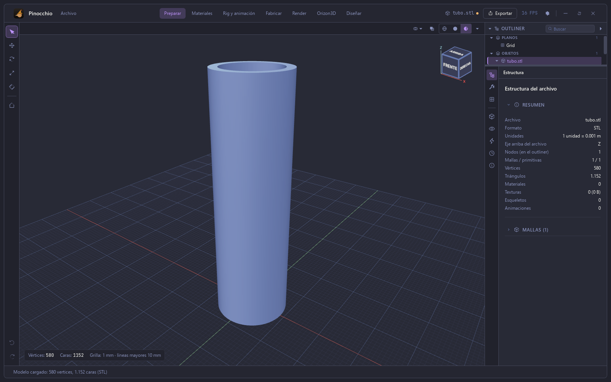
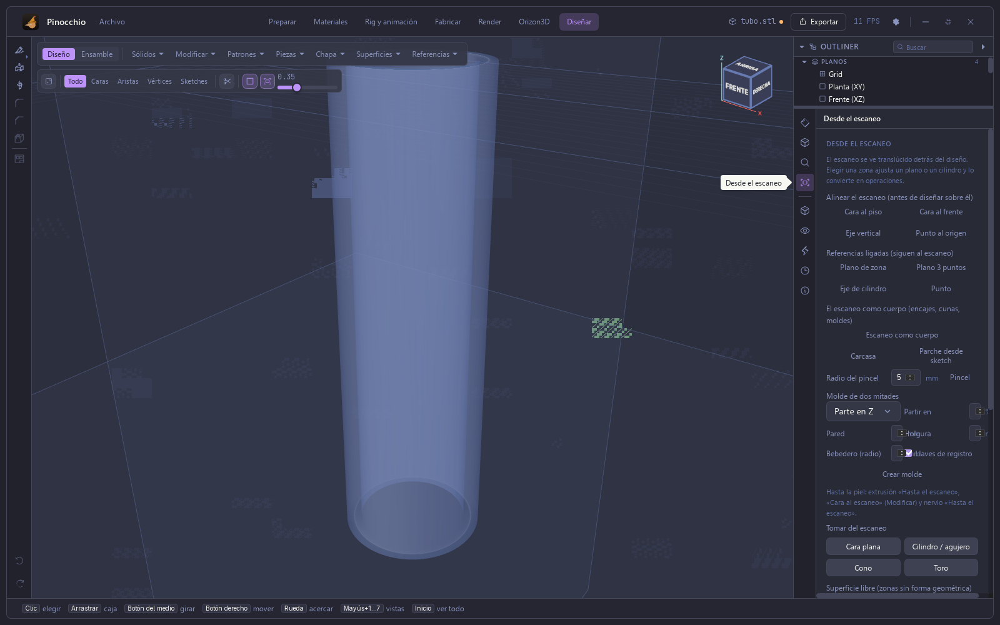
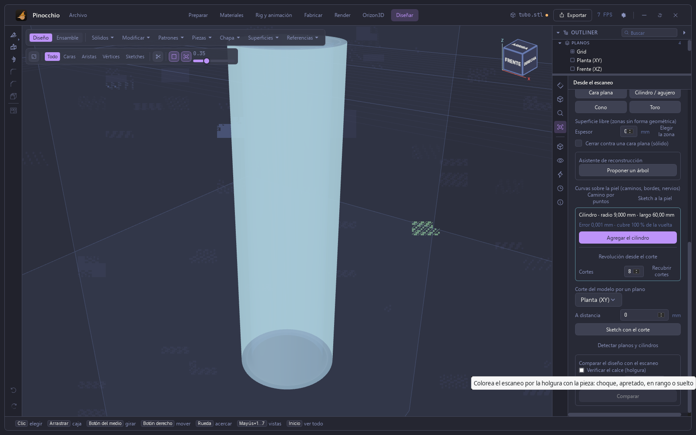
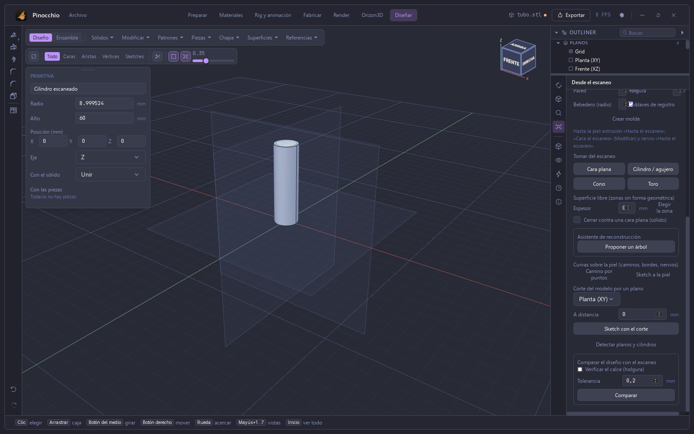
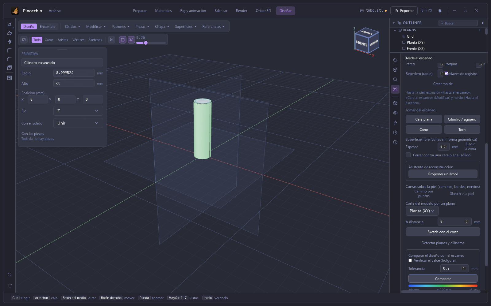

# Manual de Pinocchio — 6. Escaneo a CAD

Capturas de la app real (Tauri). Escaneo de prueba: un tubo sintético de pared
gruesa (radio exterior 9 mm, interior 7 mm, 60 mm de alto, 1.152 triángulos),
importado como STL.

## Importar el escaneo

Un STL se importa con **Archivo ▸ Importar modelo** (Ctrl+I). La pestaña
**Estructura** muestra 580 vértices y 1.152 triángulos, con unidades en mm y eje
arriba Z.

## Diseñar sobre el escaneo

En **Diseñar**, el icono de «Desde el escaneo» (el cuarto del panel derecho) abre
las herramientas que usan el escaneo como referencia. El escaneo se ve
translúcido detrás del diseño: elegir una zona ajusta un plano o un cilindro y lo
convierte en operaciones.

Las herramientas son: **Alinear el escaneo** (cara al piso, cara al frente, eje
vertical, punto al origen), **Referencias ligadas** que siguen al escaneo (plano
de zona, plano por 3 puntos, eje de cilindro, punto), el **escaneo como
cuerpo** (carcasa, parche desde sketch, pincel), el **molde de dos mitades**,
**Tomar del escaneo** (cara plana, cilindro / agujero, cono, toro), superficie
libre, el asistente de reconstrucción, las curvas sobre la piel, el corte por un
plano, **Detectar planos y cilindros** y **Comparar el diseño con el escaneo**.

## Cilindro con un clic

**Cilindro / agujero** y un clic sobre la pared del tubo ajustan un cilindro a
esa zona. La zona elegida se tiñe y el panel informa: «Cilindro · radio
9,000 mm · largo 60,00 mm. Error 0,001 mm · cubre 100 % de la vuelta».

**Agregar el cilindro** crea una primitiva «Cilindro escaneado» con radio 8,999524
mm y alto 60 mm, sobre el eje Z, para unir al sólido.

## Comparar con el escaneo

**Comparar** colorea el escaneo según la distancia a la pieza diseñada, con
tolerancia ajustable (0,2 mm por defecto) y una escala de «dentro» a «fuera». La
pieza que calza con el escaneo se ve verde.

